# Ludvig Aldén 

I build software end to end, and the AI that goes into it, in Python, TypeScript, Go, and Rust.

### Health data

- **[vocabmod-se](https://github.com/ludvigalden/vocabmod-se)** (Rust, KDL) is an open corpus that links 23 Swedish health-data code systems to SNOMED CT, LOINC, ATC, RxNorm, and OMOP standard concepts. Its 110,101 mappings are kept as plain text, each with a confidence tier, and a command-line tool exports them as OMOP vocabulary tables and FHIR ConceptMaps. No domain expert has reviewed the mappings.
- **[ehr-omop-meds-femr](https://github.com/ludvigalden/ehr-omop-meds-femr)** (Python) maps Swedish clinical source terms onto OMOP standard concepts and builds the MEDS extracts, label sets, and concept set that a clinical foundation model consumes.
- **[ehr-clmbr-training](https://github.com/ludvigalden/ehr-clmbr-training)** (Python) adapts the CLMBR-T-Base clinical foundation model to a new patient population, with continued pretraining on MEDS data, linear-probe task heads, statistical evaluation, and serving behind one command line. It is validated end to end on synthetic data.

### Tooling

- **[kdlith](https://github.com/ludvigalden/kdlith)** (Rust) processes KDL documents as typed streams from schema definitions and generates Rust processors for them. The schemas are written in a meta-schema that describes itself. kdlith is pre-release, and vocabmod-se is built on it.
- **[toolkit-go](https://github.com/ludvigalden/toolkit-go)** (Go) holds shared packages for command-line tools, covering CLI wiring, output modes, layered configuration, cross-process locks, a subprocess runner, and self-update.

### Demos

- **[market-plan-demo](https://github.com/ludvigalden/market-plan-demo)** (Python, TypeScript; [live](https://market-plan.demo.ludvigalden.com)) is a campaign planner for a fictional brand. Deterministic code finds the holiday clashes, the model may only suggest what to do about them within a fixed schema, and nothing changes until a planner accepts the suggestion.
- **[tecken-demo](https://github.com/ludvigalden/tecken-demo)** (TypeScript, Vue; [live](https://tecken.demo.ludvigalden.com)) plays recorded Swedish Sign Language for a handful of everyday phrases, with captions and the source and license of every clip. It demonstrates accessibility, testing, and open-source practice, and it translates and generates nothing.
- **[copilot-azure-demo](https://github.com/ludvigalden/copilot-azure-demo)** (C#, TypeScript, Python; [live](https://copilot-azure.demo.ludvigalden.com)) is an IT-support assistant on ASP.NET Core, React, and Microsoft Entra ID. It answers from a small knowledge base and cites the articles it used. Every Azure resource is defined in Terraform, and the release pipeline has an evaluation gate.

market-plan-demo and copilot-azure-demo are published to be read, with all rights reserved.

### Archive

- **[exectx](https://github.com/ludvigalden/exectx)** (TypeScript) provides cancelable, type-safe executions and contexts, with React hooks.

### Elsewhere

- [ludvigalden.com](https://ludvigalden.com/) describes what I do and how to start a conversation.
- [demo.ludvigalden.com](https://demo.ludvigalden.com) holds walkthroughs of agent systems, with access on request.
- [LinkedIn](https://www.linkedin.com/in/ludvigalden) is the best place to reach me.

  <picture>
    <source media="(prefers-color-scheme: dark)" srcset="https://raw.githubusercontent.com/ludvigalden/ludvigalden/main/assets/github/trail-animated-on-dark.svg">
    <source media="(prefers-color-scheme: light)" srcset="https://raw.githubusercontent.com/ludvigalden/ludvigalden/main/assets/github/trail-animated-on-light.svg">
    
  </picture>

